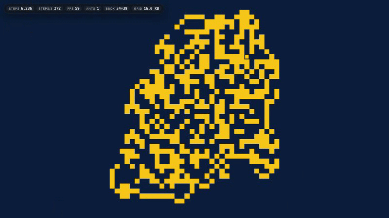

# Langton's Ant — an interactive 2D Turing-machine simulator

<div align="center">

**langtons-ant** — an interactive 2D Turing-machine simulator. Deterministic, seeded, permalink-sharable.

[](LICENSE)
[](https://exios66.github.io/langtons-ant/)
[](tests/)
[](package.json)

</div>

<p align="center">
  
</p>

## What is this?

In 1986 Christopher Langton asked what a single "ant" following four trivial rules could build. The classic ant paints ~10,000 steps of pseudo-random noise, then abruptly locks into a clean 104-step periodic highway it extends forever — and whether this *always* happens is still an open conjecture. Generalized ants ("turmites") turn out to be programmable matter: Langton's ant is provably universal (2002) [2], and all nontrivial 2D Turing machines of this kind are Turing-universal [3]. Between 2024 and 2025 whole families of multi-color ants finally had their highways proven [6][7][8] — turning the Highway Conjecture from folklore into real mathematics [14].

This app runs those machines live in your browser: any ant on an unbounded grid, seeded and deterministic, painted at millions of steps per second, with every run addressable by a URL fragment.

## Live demo

**[https://exios66.github.io/langtons-ant/](https://exios66.github.io/langtons-ant/)**

## Table of contents

- [What is this?](#what-is-this)
- [Live demo](#live-demo)
- [Run locally](#run-locally)
- [Features](#features)
- [Architecture](#architecture)
- [Rule formats](#rule-formats)
- [Preset gallery](#preset-gallery)
- [Benchmarks](#benchmarks)
- [Development](#development)
- [Deployment](#deployment)
- [Roadmap](#roadmap)
- [References](#references)
- [License](#license)

## Run locally

Requires Node.js ≥ 20 (Node 22 recommended, no runtime npm dependencies — only dev tooling).

```sh
npm ci          # install dev dependencies from the lockfile
npm run dev     # Vite dev server
npm run build   # type-check (tsc --noEmit) + production build to dist/
npm test        # vitest, the full suite
```

The throughput benchmark is gated so plain test runs stay fast:

```sh
RUN_BENCH=1 npx vitest run tests/bench.test.ts
```

## Features

| Area | What it gives you |
| --- | --- |
| Engine | Any N-color × M-state rule (up to 32 colors × 16 states), in all four notations; allocation-free step hot loop |
| Renderer | Chunked typed-array unbounded grid; dirty-rect Canvas2D painting (only cells changed this frame are drawn) |
| Determinism | Seeded, fully reproducible runs; the full UI state round-trips through the URL hash (`#r=…&a=…&s=…&z=…&c=…&x=…`) as a permalink |
| Presets | A curated gallery of verified landmark machines (below), each with notation, milestone and source |
| Colony mode | Run many ants at once — every ant acts each step in array order |
| Export / telemetry | Grid export (RLE) and lightweight run telemetry in the UI |

## Architecture


Three deliberate choices and why:

- **Everything on the main thread.** A `SharedArrayBuffer` worker data path needs `COOP`/`COEP` response headers, and GitHub Pages cannot serve them. The single-threaded hot loop is fast enough (below) without them.
- **Chunked typed arrays instead of a sparse `Map`.** The grid grows in 64×64-cell chunks (`Uint8Array`, 4 KiB per chunk). A hash-map entry *per cell* costs ~100× more memory for the same state; per-chunk allocation gives the unbounded grid O(1) indexed access with tiny bookkeeping.
- **Dirty rects.** Each ant moves exactly one cell per step, so a frame touches at most `liveCount` cells. The renderer repaints only those cells and calls `sim.resetChanged()` — no full-canvas redraws even at millions of steps per frame.

## Rule formats

The engine accepts four notations, all interconvertible (`ruleToString` picks the shortest canonical form):

| Notation | Grammar / domain | Examples |
| --- | --- | --- |
| Ant string | `L` `R` `N` `U` sequence for N-color ants | `RL` (classic), `LLRR`, `RRLLLRLLLRRR` |
| Triples | `{{turn, next-state, write}, …}` per (state, color), relative turns by letter code, absolute turns as bare or quoted letters | `{{{1,2,0},{0,8,0}}}`, `{{{0,'S',1},{1,'W',1}}}` |
| Decimal ID | Wikipedia-Commons 2-color switched-tape-style decimal encoding | `111180121010` |
| (rules with absolute headings / multi-state) | any of the above through the triple encoding | `{{{0,'N',1},{1,'S',1}}}` — absolute-heading turmites |

**Chirality convention** (matching the GollyGang Rule Table Repository [10]): **color 0 → turn RIGHT**, left/next-state indexing is state-major (`idx = state * colors + color`); `mirrorRule` provides the voluntary L↔R flip for the UI.

**Rejected:** additive split codes (later "extinct-phase"-style additive encodings) — the parser throws rather than misreading them.

## Preset gallery

All presets are verifiable landmark machines sourced from Wikipedia [12], the GollyGang Rule Table Repository [10], and the terminating-turmites repository [11]. Chirality convention: color 0 → turn RIGHT.

| Name | Notation | Space | Known milestone |
| --- | --- | --- | --- |
| Classic Langton's Ant ⭐ | `RL` | 1 state × 2 colors, relative | highway onset ≈ 9,977 steps (self-measured) |
| RLR — The Mystery | `RLR` | 1 state × 3 colors, relative | chaotic growth; no known highway |
| LLRR (ant 12) | `LLRR` | 1 state × 4 colors, relative | ever-growing bilateral symmetry |
| LRRL (ant 9) | `LRRL` | 1 state × 4 colors, relative | chiral mirror twin of LLRR |
| LRRRRRLLR | `LRRRRRLLR` | 1 state × 8 colors, relative | fills a solid square, spirals through it |
| RRLLLRLLLRRR | `RRLLLRLLLRRR` | 1 state × 12 colors, relative | marching filled triangle, ~15,900 steps |
| LLLR — Harmonic Highways | `LLLR` | 1 state × 4 colors, relative | proven harmonic highways (Lutfalla 2024–25) [6] |
| LLRLRL — Infinitely Many | `LLRLRL` | 1 state × 6 colors, relative | infinitely many highways, periods 220 + 24n [8] |
| LLRRRL — The Counterexample | `LLRRRL` | 1 state × 6 colors, relative | provably *no* extended highway [7] |
| Jeronimus — Longest Chaos | `{{{1,2,1},{0,8,1}},{{1,8,1},{0,1,0}}}` | 2 states × 2 colors, relative | highway after ≈ 8.36 × 10⁹ steps |
| Perfectionist | `{{{0,'S',1},{1,'W',1}},{{1,'E',2},{1,'S',2}},{{1,'W',0},{0,'N',0}}}` | 3 states × 2 colors, absolute | highway after ≈ 15.5 × 10⁶ steps |
| NKS p.185(e) — Not Random | `{{{1,'N',1},{0,'S',1}},{{1,'S',3},{0,'N',2}},{{1,'W',0},{1,'N',1}},{{1,'S',2},{0,'E',1}}}` | 4 states × 2 colors, absolute | proved periodic, period 2,074,575 [9] |
| Commons Chaos→Highway | `121021110111` | 2 states × 2 colors, relative | texture first, highway later |
| Base-φ Counter | `{{{0,'N',2},{1,'S',1}},{{0,'E',0},{0,'S',0}},{{1,'W',1},{1,'N',2}}}` | 3 states × 2 colors, absolute | logarithmic growth, counting in base φ |

<details>
<summary>Full preset list (21) — remaining machines</summary>

| Name | Notation | Space | Known milestone |
| --- | --- | --- | --- |
| LLRRRLRLRLLR | `LLRRRLRLRLLR` | 1 state × 12 colors, relative | convoluted diagonal highway |
| Brady Busy Beaver (S = 121) | `{{{1,2,1},{1,1,0}},{{1,4,0},{1,0,0}}}` | 2 states × 2 colors, relative | halts at step 121 |
| Brady Sigma Champion (37 cells) | `{{{1,8,0},{0,8,1}},{{1,0,0},{1,2,0}}}` | 2 states × 2 colors, relative | halts after 37 painted cells |
| Fay Champion | `{{{1,2,1},{2,4,1},{2,0,0}},{{1,2,0},{1,1,1},{1,4,1}}}` | 2 states × 3 colors, relative | halts after 59,348,218 steps / 888,629 cells |
| Commons Spiral | `111180121010` | 2 states × 2 colors, relative | intricate spiral texture |
| Commons Fibonacci Spiral | `181181121010` | 2 states × 2 colors, relative | order that reads like geometry |

</details>

Every preset loads with one click in the live demo and is addressable by a permalink (`#r=<rule>&a=…&s=…`).
## Benchmarks

Measured with the committed gated benchmark (`RUN_BENCH=1 npx vitest run tests/bench.test.ts`),
5 runs of 1,000,000 steps each after a 50,000-step warm-up, engine untouched (`src/engine/**` as shipped):

| Series | Mean ms / run | Throughput | Cell-updates/s |
| --- | --- | --- | --- |
| Classic `RL` ant, single | 50.9 | **19.65M steps/s** | 19.65M |
| Colony of 25 ants | 1,866.6 | 0.54M steps/s | **13.39M** |

Method: Node v22.14.0, macOS 26.3, Apple M2 (arm64), `console.log` timings — the benchmark asserts nothing numeric so throughput can never become a flaky CI gate. Per-run raw times are printed at INFO level above the mean line.

The throughput *determinism* is pinned separately: after exactly **11,000 classic-ant steps** from a blank grid, the visited region hashes to the committed constant **`6219b3fb`** (FNV-1a) — asserted in `tests/golden.test.ts` on every Node version and OS, including the 104-step periodic highway tail [1][12].

## Development

### Project layout

<details>
<summary>Repository layout</summary>

```text
.
├── index.html
├── src/
│   ├── app/                # rAF loop, UI, URL-state / permalinks
│   ├── render/             # palette, dirty-rect Canvas2D renderer
│   └── engine/             # frozen: rule, grid, simulation, serialize, hash, prng, presets
├── tests/                  # vitest: rule, grid, simulation, serialize, golden, bench
├── scripts/                # deploy.mjs (branch-based Pages publish)
├── public/                 # static assets served at site root (social-card.png, .nojekyll)
├── vite.config.ts          # base: '/langtons-ant/', es2022 target, sourcemaps
└── vitest.config.ts        # node environment, tests/**/*.test.ts
```

</details>

### Scripts

<details>
<summary>npm scripts</summary>

| Script | What it does |
| --- | --- |
| `npm run dev` | Vite dev server |
| `npm run build` | `tsc --noEmit` + `vite build` → `dist/` |
| `npm run preview` | Serve the production build locally |
| `npm test` / `npm run test:watch` | Vitest suite (the gated bench stays skipped unless `RUN_BENCH=1`) |
| `npm run deploy` | `npm run build`, then publish `dist/` to the `gh-pages` branch via a temporary worktree |

</details>

### Testing

- `tests/golden.test.ts` pins the 11,000-step FNV-1a digest (determinism, chunk addressing, rule table).
- `tests/bench.test.ts` (gated by `RUN_BENCH=1`) plus suites for the four rule parsers, the chunked grid, the simulation, and RLE/ant-packing round-trips.

### Deployment

Branch-based GitHub Pages — **no Actions deployment required**:

1. Repository *Settings → Pages → Build and deployment → Source*: **Deploy from a branch**, branch `gh-pages`, folder `/ (root)` (one-time setup).
2. `npm run deploy` builds and publishes the current build to `gh-pages`, which serves https://exios66.github.io/langtons-ant/ until the next publish. Re-run it any time the source changes.
3. Optional: to make the repo citable, enable Zenodo on the repository and create a release (mints a concept + version DOI), then add the DOI to `CITATION.cff`.

## Roadmap

- **M2/M3:** animated GIF/WebM export of run regions; a live highway detector with an "onset" milestone badge; side-by-side rule comparison mode; in-app rule-format documentation; Playwright visual regression tests.

## References

Cite this repository: see [`CITATION.cff`](./CITATION.cff) (GitHub renders APA + BibTeX via the "Cite this repository" button). Full bibliography of all 139 sources the project and its research rely on: [`citations.bib`](./citations.bib).

Numbered entries below are those the README's own claims depend on; each `[N]` in the text points here.

1. Langton, C. G. "Studying artificial life with cellular automata." *Physica D* 22(1–3) (1986): 120–149. https://deepblue.lib.umich.edu/bitstream/2027.42/26022/1/0000093.pdf
2. Gajardo, A., A. Moreira, E. Goles. "Complexity of Langton's ant." *Discrete Applied Mathematics* 117 (2002): 41–50. https://arxiv.org/abs/nlin/0306022
3. Gajardo, A., B. Hellouin de Menibus, D. Maldonado, A. Moreira. "Nontrivial Turmites Are Turing-Universal." arXiv:1702.05547 (2017). https://arxiv.org/abs/1702.05547
4. Bunimovich, L. A., S. E. Troubetzkoy. "Recurrence properties of Lorentz lattice gas cellular automata." *J. Stat. Phys.* 67 (1992): 289–302. https://doi.org/10.1007/BF01049035
5. Gale, D., J. Propp, S. Sutherland, S. Troubetzkoy. "Further Travels with My Ant." arXiv:math/9501233 (1995). https://arxiv.org/abs/math/9501233
6. Gajardo, A., V. Lutfalla, M. Rao. "Ants on the highway." *Natural Computing* (May 2025). https://arxiv.org/abs/2409.10124
7. Lutfalla, V. "Sideways on the highways." arXiv:2505.05426 (2025). https://arxiv.org/abs/2505.05426
8. Lutfalla, V. "The LLLR generalised Langton's ant." arXiv:2506.10482 (2025). https://arxiv.org/abs/2506.10482
9. Wolfram, S. *A New Kind of Science*, §5.3. Wolfram Media (2002). https://www.wolframscience.com/nksonline/section-5.3
10. GollyGang. "TwoDimensionalTuringMachines" (Rule Table Repository wiki). https://github.com/GollyGang/ruletablerepository/wiki/TwoDimensionalTuringMachines (accessed 2026-10-17)
11. GollyGang. terminatingturmites repository. https://github.com/gollygang/terminatingturmites (accessed 2026-10-17)
12. Wikipedia contributors. "Langton's ant." https://en.wikipedia.org/wiki/Langton%27s_ant (accessed 2026-10-17)
13. Wikipedia contributors. "Turmite." https://en.wikipedia.org/wiki/Turmite (accessed 2026-10-17)
14. MathOverflow community. "Intermediate results for Langton's ant highway conjecture." (2017). https://mathoverflow.net/questions/277040/intermediate-results-for-langtons-ant-highway-conjecture
15. Matpic. "An ant that builds a highway." https://www.matpic.com/essays/an-ant-that-builds-a-highway/ (accessed 2026-10-17)
16. Hackspeare, W. "A Bestiary of Turmites." https://williamhackspeare.github.io/turmite-bestiary (accessed 2026-10-17)

## License

[MIT](LICENSE) © 2026 Exios66

Citation: see [`CITATION.cff`](./CITATION.cff). Full bibliography of all 139 sources: [`citations.bib`](./citations.bib).
